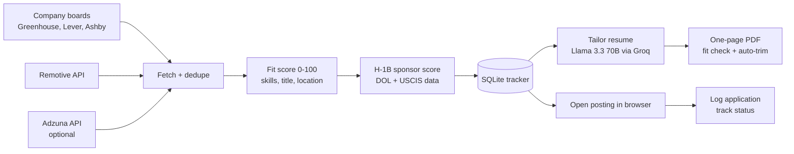

# Job Hunter


A command-line tool that finds job postings through **official job APIs**, scores each one
against your skills, and uses an LLM to **tailor your resume into a one-page, ATS-friendly PDF**.
It tracks every job and application in a local database.

You stay in control of applying: Job Hunter opens the posting in your browser and you submit
the application yourself. It never logs in to job boards, scrapes them, or applies for you.

## How it works



| Stage | What it does |
|---|---|
| **Fetch** | Reads your target companies' own Greenhouse, Lever and Ashby boards, plus [Remotive](https://remotive.com/) (remote jobs) and, if you have keys, [Adzuna](https://developer.adzuna.com/). Removes duplicates of the same title + company across sources and across runs. |
| **Score** | 0–100 per job: keyword match with your weighted skills (50), title match with your target roles (30), preferred location (20). Jobs below `min_score` are skipped. |
| **Tailor** | Sends your base resume and the job description to Llama 3.3 70B with rules: match keywords and reorder, but **never invent** experience; keep every item in your `must_keep` list. |
| **Fit to one page** | Renders the PDF and measures how full the page is. If it overflows, it removes one wrapped line at a time from the bullet that loses the fewest words. If it's under 85% full, it asks the LLM for more detail. |
| **Track** | Stores jobs and applications in SQLite; update status as you hear back (interview, offer, rejected...). |

## Company career boards

Many companies publish their openings through **public job-board APIs** on Greenhouse, Lever
and Ashby (the feeds that power their own careers pages). Large employers often use **Workday**
instead; their career sites (`https://<company>.wd<N>.myworkdayjobs.com/<site>`) load postings
from a JSON endpoint that their robots.txt doesn't exclude. Job Hunter reads it politely: your
search queries only, a few pages each, a pause between requests, and a detail request only for
recent postings whose title matches and isn't excluded. Add a Workday site as a row with
`ats = workday` and the career site URL as `slug`. `discover-boards` takes your top
H-1B sponsors, tries likely board names for each one (checking the company name where the API
returns it), and writes `data/company_boards.csv`. Every `search` then reads those boards and
keeps postings that:

- match one of your `preferred_titles`,
- are one of your `job_types` (full_time, part_time, intern, contract; classified from the
  title and the board's employment type),
- are in the US, or remote without another country named,
- were posted within `max_days_old` days.

```bash
python -m jobhunter discover-boards --top 300 --min-filings 10   # once, then occasionally
python -m jobhunter search                                        # includes the boards
```

Review `data/company_boards.csv` after discovery and delete any row that points at a different
company with a similar name. Companies that build their own careers sites (Amazon, Google,
Meta, Microsoft, Apple and others) aren't covered; check their careers pages yourself.

## H-1B sponsorship

Every job also gets an **H-1B sponsor score** (0-100) from the
[H-1B Tech Jobs Tracker](https://github.com/srikanthmannepalli0502-cmyk/h1b-job-market-tracker):
`data/h1b_sponsors.csv` lists 30,000+ employers with their certified H-1B LCA filings
(U.S. Department of Labor, Oct 2024 - Jun 2026) by role group, how many months they filed in,
new H-1B hires, and USCIS new-hire denial rates.

- The posting's company name is matched to the filings: exact legal names, brand names
  ("Capital One" -> Capital One Services, LLC), "d/b/a" names, and a few abbreviations (EY, PwC).
  When the match isn't exact, the note names the employer it matched so you can check it.
- **Score:** filings in your target roles (40), all filings (15), months with filings (15),
  new H-1B hires (15), USCIS new-hire approval (15).
- **Ranking:** `overall = fit x (1 - weight) + sponsor x weight`, with `weight` (default 35) in
  `[sponsorship]` in profile.toml. Set `hide_non_sponsors = true` to drop companies with no filings.

```bash
python -m jobhunter sponsor "Capital One"      # look up any company
python -m jobhunter list --sponsors-only       # hide companies with no H-1B filings
```

To refresh the data after a new DOL release, run `python -m pipeline.export_sponsors --out
<path to this repo>/data/h1b_sponsors.csv` in the tracker repo.

An LCA filing shows that an employer sponsored the role, not that it will sponsor you; and this is
not legal or immigration advice.

## Setup

Requires Python 3.11+.

```bash
git clone https://github.com/srikanthmannepalli0502-cmyk/job-hunter-auto.git
cd job-hunter-auto
python -m venv .venv
.venv\Scripts\activate          # Windows
# source .venv/bin/activate     # macOS / Linux
pip install -r requirements.txt
```

1. **API keys:** copy `.env.example` to `.env` and add:
   - `GROQ_API_KEY`: free at https://console.groq.com/keys
   - `ADZUNA_APP_ID` / `ADZUNA_APP_KEY` (optional): https://developer.adzuna.com/. New accounts get
     25 test calls; regular use is a paid plan. Without keys, Adzuna is skipped.
     (Remotive needs no key.)
2. **Profile:** copy `profile.example.toml` to `profile.toml` and set your search, skill weights,
   target titles and `must_keep` items (project and certification names).
3. **Resume:** put your base resume at `resumes/base_resume.pdf` (or `.docx`).

`.env`, `profile.toml`, your resumes and the database are all gitignored.

## Usage

```bash
python -m jobhunter search                 # fetch, score and store new jobs
python -m jobhunter list                   # top jobs you haven't applied to
python -m jobhunter tailor 12              # tailored PDF for job #12
python -m jobhunter tailor 12 --jd-file jd/acme.txt   # ...using the full posting text
python -m jobhunter open 12                # open posting, then log that you applied
python -m jobhunter status 3 interview --notes "Phone screen Mon"
python -m jobhunter applications           # your application history
python -m jobhunter sponsor "Capital One"   # H-1B sponsorship of a company
```

**Tip:** Adzuna's API returns a shortened description. For the best tailoring, copy the full
posting into a text file and pass `--jd-file`.

**Always review the tailored resume before sending it.** LLMs can make mistakes.

## Project layout

```
jobhunter/
├── cli.py              # commands
├── config.py           # .env settings + profile.toml loader
├── models.py           # JobListing
├── scoring.py          # 0-100 job scoring
├── sponsors.py         # H-1B sponsor matching and score
├── tracker.py          # SQLAlchemy models + job/application store
├── llm.py              # Groq client with rate-limit retries
├── sources/
│   ├── base.py         # JobSource interface, dedupe, exclusions
│   ├── adzuna.py       # Adzuna API
│   ├── boards.py       # Greenhouse / Lever / Ashby / Workday career sites + discovery
│   └── remotive.py     # Remotive API
└── resume/
    ├── parser.py       # read PDF/DOCX resumes
    ├── pdf.py          # ATS-friendly PDF rendering + page-fit check
    └── tailor.py       # prompt, must-keep validation, one-page trimming
tests/                  # pytest suite (APIs mocked, LLM faked); runs in GitHub Actions
```

## Testing

```bash
pip install -r requirements-dev.txt
pytest
```

The tests mock the job APIs and the LLM, so they need no keys or network access.

## Responsible use

- Job data comes only from official APIs, used within their terms. Remotive asks API users to
  link back to postings and credit Remotive as the source; please do.
- No automated logins, scraping or auto-submission. Applying stays a human decision.
- Groq's free tier allows a limited number of requests per day; tailoring retries on rate limits.

## License

For personal and educational use.
